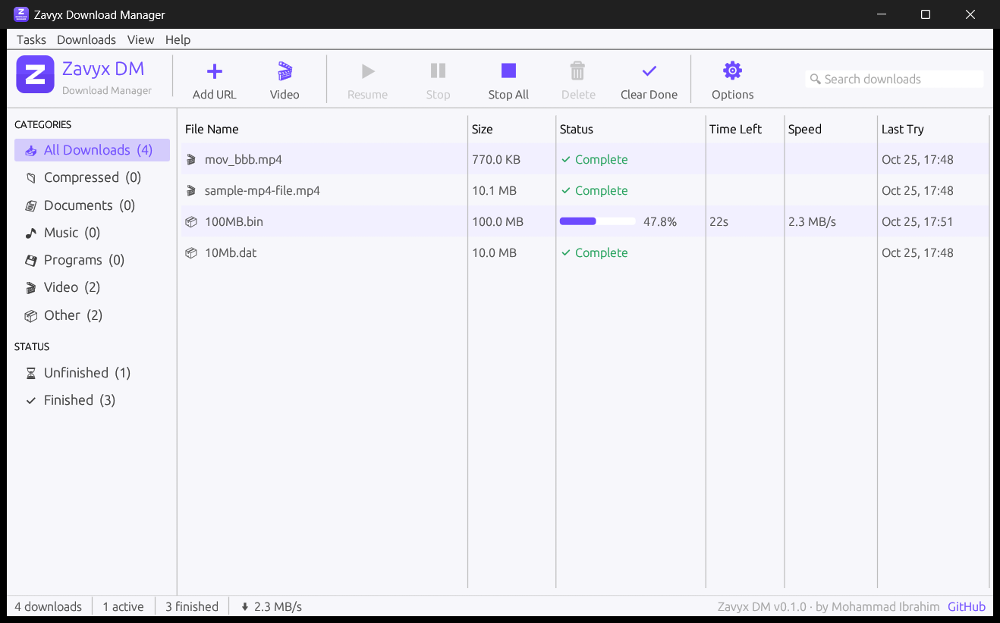

<p align="center">
  
</p>

<h1 align="center">Zavyx Download Manager</h1>

<p align="center"><sub>Zavyx DM · part of the <a href="https://github.com/mohammadibrahimdev/zavyx">Zavyx</a> family of free tools</sub></p>

<p align="center">
  <b>Fast, free and open-source download manager for Windows.</b><br>
  Multi-connection downloads · one-click video downloads from your browser · no ads, no trial, no tracking.
</p>

<p align="center">
  <a href="https://github.com/mohammadibrahimdev/zavyx-download-manager/releases/latest"></a>
  <a href="LICENSE"></a>
  
</p>

<p align="center">
  
</p>

---

## ✨ Features

- **Faster downloads** — each file is split into up to 32 parallel connections.
- **Pause & resume** — stop any download and continue later, even after closing the app.
- **Video downloads** — YouTube, Facebook, Instagram, TikTok, X/Twitter, Vimeo and 1000+ sites (powered by yt-dlp). Pick the quality: 1080p, 720p, audio only…
- **Browser integration** — a *Download* button appears on videos, plus “Download with Zavyx DM” in the right-click menu. Works in Chrome, Edge, Brave, Opera, Vivaldi and Firefox.
- **Streams** — save HLS (`.m3u8`) and DASH (`.mpd`) streams as MP4.
- **Batch downloads** — grab numbered series like `photo_01.jpg … photo_99.jpg` in one go.
- **Organised** — downloads sorted into Video, Music, Documents, Programs and Compressed.
- **Clean & light** — native app written in Rust, light and dark themes.

## ⬇ Download & install

1. Go to the **[latest release](https://github.com/mohammadibrahimdev/zavyx-download-manager/releases/latest)**.
2. Download **`ZavyxDM-Setup-x.y.z.exe`** and run it. No admin rights needed.
3. Add the browser extension (below).

Prefer no installer? Download the **portable ZIP**, unzip it anywhere, run `ZavyxDM.exe`, and double-click `Connect browsers.bat` once.

> Windows SmartScreen may warn about a new app from an unknown publisher. Click **More info → Run anyway**.

## 🧩 Browser extension

The extension sends links and videos from your browser to Zavyx DM.

**Chrome, Edge, Brave, Opera, Vivaldi**
1. Download **`ZavyxDM-extension-x.y.z.zip`** from the release page and unzip it.
2. Open your browser’s extensions page (`chrome://extensions`, `edge://extensions`, …).
3. Turn on **Developer mode**, click **Load unpacked**, and choose the unzipped folder.
4. Click the Zavyx DM icon in the toolbar — it should say **Connected**.

**Firefox:** open `about:debugging#/runtime/this-firefox` → **Load Temporary Add-on** → pick `manifest.json` from the unzipped folder.

Zavyx DM opens automatically when you send it a download, so it doesn’t need to be running.

## 🛠 Build from source

Requirements: [Rust](https://rustup.rs) (stable) on Windows.

```bash
git clone https://github.com/mohammadibrahimdev/zavyx-download-manager.git
cd zavyx-download-manager
cargo build --release
```

The app is `target\release\ZavyxDM.exe`. To build the installer, portable ZIP and extension ZIP like the official release (needs [Inno Setup 6](https://jrsoftware.org/isinfo.php) for the installer):

```bash
powershell -ExecutionPolicy Bypass -File scripts\package.ps1
```

### Project layout

| Folder | What it is |
| --- | --- |
| `crates/zavyx-dm-gui` | The desktop app (`ZavyxDM.exe`), built with egui |
| `crates/zavyx-dm-core` | Download engine: queue, multi-connection downloads, resume |
| `crates/zavyx-dm-native-messaging` | Bridge between the browser extension and the app |
| `crates/zavyx-dm-cli` | Command-line tool (`zavyx-dm-cli.exe`) and the browser host (`zavyx-dm-host.exe`) |
| `crates/zavyx-dm-hls`, `zavyx-dm-ytdlp`, `zavyx-dm-ffmpeg` | Stream and video helpers |
| `extension/` | Browser extension (Manifest V3) |
| `installer/` | Inno Setup installer script and manual browser-registration scripts |

### Releasing a new version (maintainers)

```bash
powershell -ExecutionPolicy Bypass -File scripts\release.ps1 0.2.0
```

This updates the version numbers, runs the tests, tags `v0.2.0` and pushes. GitHub Actions then builds everything and publishes the release automatically.

## 🤝 Contributing

Bug reports, ideas and pull requests are welcome — please open an [issue](https://github.com/mohammadibrahimdev/zavyx-download-manager/issues).

## 👤 Author

Made by **Mohammad Ibrahim** — [github.com/mohammadibrahimdev](https://github.com/mohammadibrahimdev)

Zavyx DM is part of **[Zavyx](https://github.com/mohammadibrahimdev/zavyx)** — a family of free, open-source tools.

## 📄 License

[MIT](LICENSE) © Mohammad Ibrahim. Bundled third-party tools (yt-dlp, FFmpeg) keep their own licences — see [THIRD-PARTY-NOTICES.md](THIRD-PARTY-NOTICES.md).

Zavyx DM is an independent project and is not affiliated with any other download manager.
